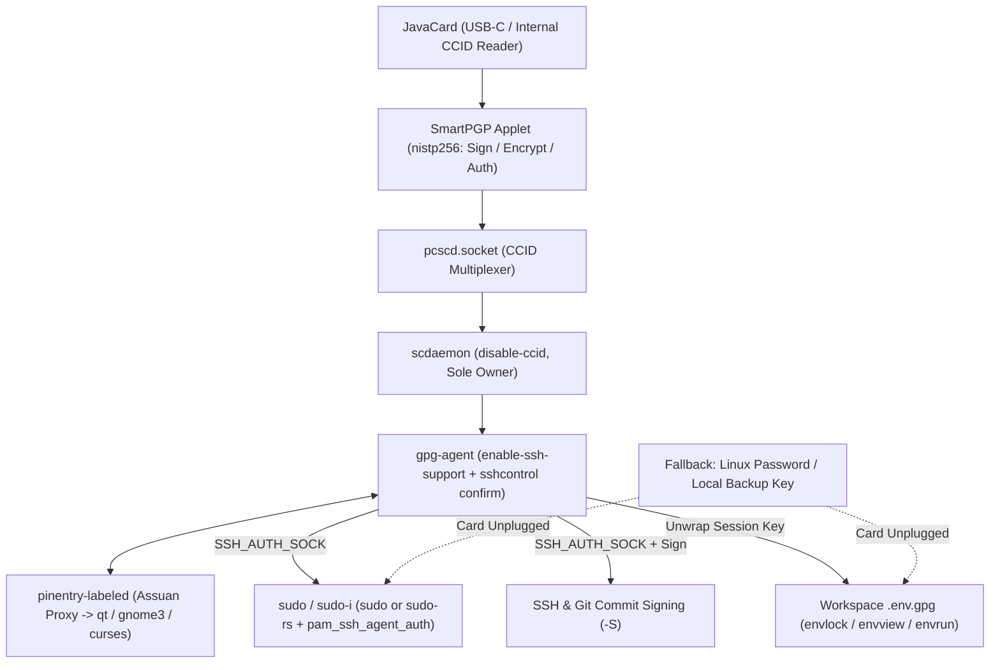
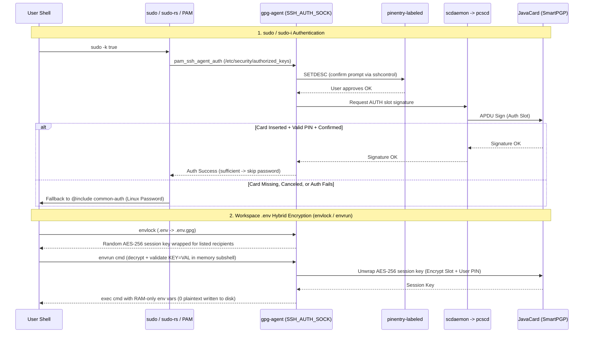

# How It Works: SmartPGP JavaCard + `sudo` / `sudo-rs` Auth

## 1. System Architecture Overview

One JavaCard running `SmartPGP` (optionally coexisting with applets such as `SeedKeeper`) handles OpenPGP Sign, Encrypt, and Auth subkeys. On the Linux host, **`pcscd` -> `scdaemon` -> `gpg-agent`** serializes all card operations through a single owner to prevent CCID reader contention.

---

## 2. End-to-End Authentication & Encryption Workflows

---

## 3. Core Security Boundaries

- **Single Reader Owner (`disable-ccid`)**: `scdaemon.conf` delegates USB CCID transport to `pcscd`, preventing libusb contention. Release `scdaemon` via `gpgconf --kill scdaemon` before using GlobalPlatform (`gp.jar`) directly.
- **No-Folding `~/.gnupg` Isolation**: `~/.gnupg` stays a real `0700` directory; only config files (`gpg-agent.conf`, `scdaemon.conf`) are managed, so private stubs and trust databases never enter Git repositories.
- **Per-Request Confirmation (`sshcontrol` `confirm`)**: Adding `confirm` after the AUTH keygrip prevents silent root `sudo` reuse while `gpg-agent` caches the User PIN.
- **Labeled Assuan Pinentry Proxy (`pinentry-labeled`)**: Decodes percent-encoded `SETDESC` strings, sanitizes control characters, injects context-specific `SETTITLE` headers, and selects `pinentry-qt`, `pinentry-gnome3`, or `pinentry-curses` automatically while guarding against self-recursion.
- **Dual PAM + Password Fallback**: Both `/etc/pam.d/sudo` and `/etc/pam.d/sudo-i` receive `auth sufficient pam_ssh_agent_auth.so file=/etc/security/authorized_keys` strictly above `@include common-auth`. `/etc/sudoers.d/ssh-agent` preserves `SSH_AUTH_SOCK` and is syntax-checked with `visudo -cf`.
- **Non-Executing `.env` Loader**: `envrun` never runs `eval` or `source <(...)`; it parses `KEY=VAL` assignments in bash parameter expansion, rejects unquoted command substitutions and invalid variable names, and passes variables exclusively to the child process.
